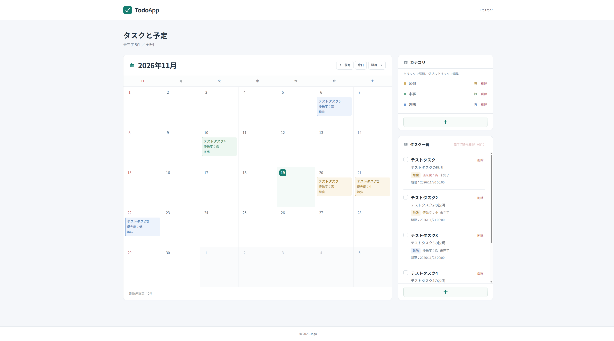
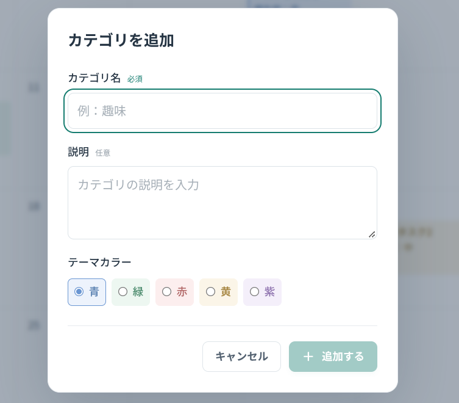
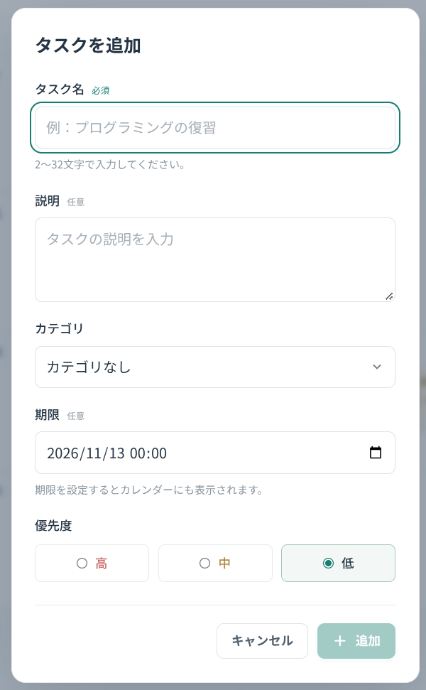

# TodoApp

公開URL：https://tomoni1130.github.io/toDoApp/

タスクの種類と期限をひと目で確認できる、カレンダー付きタスク管理アプリです。

## 開発背景・工夫

Google カレンダーでタスクの種類ごとに色を設定する手間を減らすために作りました。カテゴリに色を登録すると、所属するタスクを自動で色分けします。カレンダーとタスク一覧を同じ画面に配置し、予定と作業内容をまとめて確認できるようにしました。

ダブルクリックで追加・編集画面を開けるほか、フォームでは Ctrl + Enter で確定、Esc でキャンセルできます。

## 主な機能

- タスクの追加・編集・削除、完了切り替え、完了済みの一括削除
- タスクの説明・優先度・期限・カテゴリの設定
- カテゴリの追加・編集・削除と、5色からの色分け
- 期限に応じた月間カレンダー表示と、前月・翌月・今月への切り替え
- LocalStorage への自動保存と、再読み込み時の復元

## 使い方

- 「＋」もしくは**追加したい日をダブルクリック**でタスクやカテゴリを追加します。

- タスク名やカテゴリ名をクリックすると詳細、ダブルクリックすると編集画面が開きます。詳細内の「編集」ボタンからも編集できます。

- カレンダーの日付をダブルクリックすると、その日を期限にしたタスクを追加できます。
- チェックボックスで完了状態を切り替えます。

データは使用中のブラウザに保存されます。端末間の同期はありません。

## 使用技術

React / TypeScript / Vite / Tailwind CSS・CSS / Font Awesome（アイコン）/ UUID（ID生成）/ LocalStorage（保存）/ GitHub Pages・GitHub Actions（公開）

開発期間：2026.11.13 ～ 2026.11.19（約30時間）
