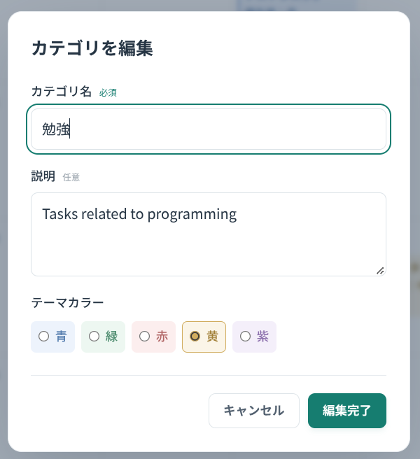
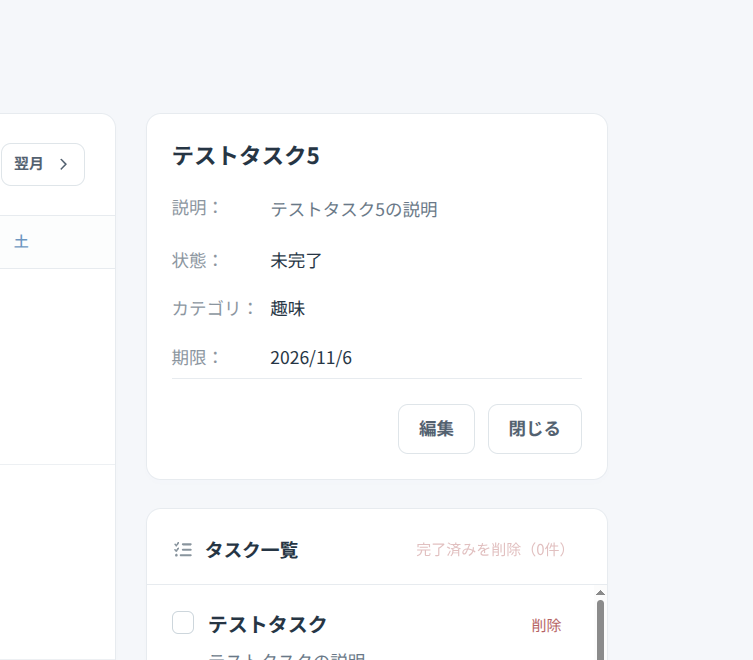

# TodoApp

公開URL：https://tomoni1130.github.io/toDoApp/

タスクの種類と期限をひと目で確認できる、カレンダー付きタスク管理アプリです。

## 開発背景・工夫

Google カレンダーでタスクの種類ごとに色を設定する手間を減らすために作りました。最初に「勉強は青」「家事は緑」のようにカテゴリと色を決めておけば、タスク登録時はカテゴリを選ぶだけで色を揃えられます。

例えば、課題の提出日と買い物の予定を登録すると、カレンダー上の色で種類を、日付で期限を確認できます。タスク一覧も同じ画面に置き、予定を見ながら説明や優先度を確認し、終わったものにチェックを付けられるようにしました。

## 主な機能

- タスクの追加・編集・削除、完了切り替え、完了済みの一括削除
- タスクの説明・優先度・期限・カテゴリの設定
- カテゴリの追加・編集・削除と、5色からの色分け
- 期限に応じた月間カレンダー表示と、前月・翌月・今月への切り替え
- LocalStorage への自動保存と、再読み込み時の復元

## 使い方

**1. カテゴリを用意する**

カテゴリ欄の「＋」から名前・説明・色を登録します。色は5色から選べます。

**2. カテゴリを編集する**

カテゴリ名をダブルクリックすると編集画面が開きます。名前や色の変更は、登録済みの関連タスクにも反映されます。

**3. タスクを追加する**

タスク欄の「＋」から、名前・説明・カテゴリ・期限・優先度を設定します。カレンダーの日付をダブルクリックすると、その日が期限に入った状態で追加画面が開きます。

**4. 詳細を確認・編集する**

タスク名をクリックすると、説明・状態・カテゴリ・期限を確認できます。「編集」ボタン、またはタスク名のダブルクリックで編集できます。

チェックボックスで完了状態を切り替えます。追加・編集フォームでは Ctrl + Enter で確定、Esc でキャンセルできます。

データは使用中のブラウザに保存されます。端末間の同期はありません。

## 使用技術

React / TypeScript / Vite / Tailwind CSS・CSS / Font Awesome（アイコン）/ UUID（ID生成）/ LocalStorage（保存）/ GitHub Pages・GitHub Actions（公開）

開発期間：2026.11.13 ～ 2026.11.19（約30時間）
